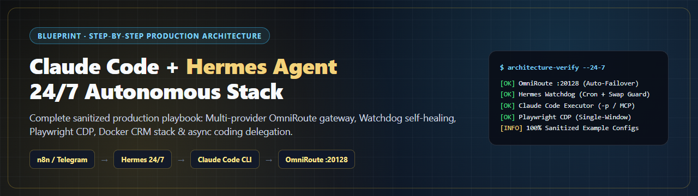

<div align="center">
  

  <p>
    <a href="README.md"></a>
    <a href="README.es.md"></a>
    
    
    
  </p>

  <h3>Guía Paso a Paso de Producción: Stack Autónomo 24/7 con Claude Code + Hermes Agent</h3>
  <p>
    Cómo arquitectar, configurar, endurecer y operar <b>Hermes Agent</b> + <b>Claude Code CLI</b> + <b>OmniRoute AI Gateway</b> + <b>n8n / WAHA / Playwright</b> en VPS Linux y Windows sin puntos únicos de fallo.
  </p>
</div>

---

> [!CAUTION]
> **Plantilla Pública 100% Sanitizada:** Todos los archivos de configuración, variables `.env`, direcciones IP (`198.51.100.10`), dominios (`your-domain.example.com`), claves API (`sk-example-replace-me`) y correos (`agency@example.com`) de este repositorio son **ejemplos ficticios**. Nunca subas archivos `.env` reales, bases SQLite, tokens OAuth ni llaves SSH a repositorios públicos. Revisa [SECURITY.md](SECURITY.md).

---

## Visión General de la Arquitectura

En una arquitectura autónoma 24/7 para agencia de software e IA:
- **Hermes Agent** actúa como **orquestador siempre activo 24/7** (atención, rutinas programadas, memoria persistente, herramientas MCP y automatización web).
- **Claude Code CLI** actúa como **ejecutor técnico pesado** (construcción de proyectos, refactorización, suites de pruebas y renderizado de video/activos).
- **OmniRoute (`http://127.0.0.1:20128/v1`)** centraliza el enrutamiento multi-proveedor, failover automático ante cuotas/rate-limits (`429`) y selección dinámica de modelos y esfuerzo de razonamiento.

```mermaid
flowchart LR
    subgraph Canales["Canales de Entrada y Control"]
        WA["WhatsApp (WAHA)"]
        TG["Bot de Telegram"]
        CW["Chatwoot / Slack"]
    end

    subgraph Core["Stack Core Docker"]
        N8N["n8n Self-Hosted"]
        PG["PostgreSQL 16 (CRM + Cola DAG)"]
        RD["Redis 7 (Debounce / Caché)"]
        QD["Qdrant (RAG Vectorial)"]
        CAD["Caddy (Proxy HTTPS Automático)"]
    end

    subgraph Agentes["Capa de Agentes Autónomos"]
        BR["Task Bridge (:5050)"]
        HM["Hermes Agent 24/7 (tmux / systemd)"]
        CC["Claude Code CLI (-p / MCP Executor)"]
        PW["Playwright MCP + Brave/Chrome CDP"]
    end

    subgraph Gateway["Enrutamiento IA Unificado"]
        OR["OmniRoute Gateway (127.0.0.1:20128)"]
        P1["Modelos Primarios (Claude / GPT / Gemini)"]
        P2["Pool de Respaldo y Ollama Local"]
    end

    WA --> N8N
    TG --> BR
    CW --> N8N
    N8N <--> PG
    N8N <--> RD
    N8N <--> QD
    N8N --> BR
    BR --> HM
    HM -->|"delegate_to_claude_code.py"| CC
    HM <--> PW
    HM -->|"OPENAI_BASE_URL"| OR
    CC -->|"ANTHROPIC_BASE_URL"| OR
    OR --> P1
    OR -.->|"Failover 429 / Timeout"| P2
```



---

## Índice de Guías Paso a Paso

Sigue estos módulos en orden secuencial para replicar todo el sistema desde cero:

1. **[01 — Bootstrap de VPS Linux, Swap/ZRAM y KDE/xRDP](docs/01-vps-bootstrap-kde-xrdp.md):** Preparación de Ubuntu LTS, ajuste de Swap/ZRAM en servidores con RAM limitada, Node.js v24, Python 3, Docker, KDE Plasma / Xvfb (`DISPLAY=:10` y `:99`), higiene SSH en Windows y dimensionamiento multi-nodo.
2. **[02 — OmniRoute AI Gateway y Failover Multi-Proveedor](docs/02-omniroute-gateway-setup.md):** Instalación en `127.0.0.1:20128`, por qué evitar `localhost` por IPv6, combos inteligentes con soporte obligatorio de *tool-calling* (`>=128k` contexto), blindaje SQLite WAL y aislamiento de refresco OAuth.
3. **[03 — Integración de Claude Code CLI como Ejecutor de Proyectos](docs/03-claude-code-integration.md):** Configuración de `~/.claude/settings.json` con `ANTHROPIC_BASE_URL`, selector `/model` + barra de esfuerzo, ejecución headless (`claude -p`, `--allowedTools`, `--output-format json`), contrato `CLAUDE.md`, Remotion, HyperFrames y GitHub MCP.
4. **[04 — Hermes Agent 24/7, Guardrails y Cola DAG Multi-Worker](docs/04-hermes-agent-24-7.md):** Instalación de `NousResearch/hermes-agent`, separación `.env` vs `config.yaml`, parámetros críticos (`busy_input_mode: queue`, `loop_watchdog`), archivos `AGENTS.md`/`SOUL.md`, migración a PostgreSQL 16 y handoffs Hermes → Claude Code.
5. **[05 — Automatización Web con Playwright MCP y Brave/Chrome CDP](docs/05-browser-automation-playwright-brave.md):** Conexión `@playwright/mcp`, higiene de ventana única y grupos de pestañas para proteger RAM, lanzador Windows `WinSta0\Default` mediante `CreateProcess` y preservación del cursor nativo.
6. **[06 — Watchdog 24/7, Task Bridge y Stack Omnicanal Docker](docs/06-watchdog-monitoring-and-omnichannel.md):** Guardián cron cada minuto (`<400 MiB` RAM libre), puente HTTP-to-tmux (`:5050`), centro de mando en Telegram y stack Docker (`PostgreSQL + Redis + n8n + WAHA + Qdrant + Caddy`).
7. **[07 — Runbook de Diagnóstico y Solución de Fallos Reales](docs/07-troubleshooting-runbook.md):** Soluciones verificadas para HTTP 400 (modelos sin tool-calling), HTTP 403, WebSocket `1006`, `SQLite database is locked`, context overflow, bucles infinitos y ventanas emergentes en Windows.

---

## Despliegue Rápido (Con Plantillas de Ejemplo)

```bash
git clone https://github.com/agenciaiaonline-wq/claude-code-hermes-24-7-automation.git
cd claude-code-hermes-24-7-automation

# 1. Crear .env local desde la plantilla sanitizada
cp configs/.env.example .env

# 2. Instalar y verificar OmniRoute en 127.0.0.1:20128
npm install -g omniroute
curl -s http://127.0.0.1:20128/health

# 3. Configurar Claude Code CLI hacia OmniRoute
mkdir -p ~/.claude
cp configs/claude-settings.example.json ~/.claude/settings.json

# 4. Instalar Hermes Agent y aplicar configuración endurecida
curl -fsSL https://hermes-agent.nousresearch.com/install.sh | bash
mkdir -p ~/.hermes
cp configs/hermes-config.example.yaml ~/.hermes/config.yaml
cp configs/AGENTS.example.md ~/.hermes/AGENTS.md

# 5. Levantar stack Docker Core (Postgres, Redis, n8n, WAHA, Qdrant)
docker compose -f docker/docker-compose.example.yml --env-file .env up -d
```

---

<div align="center">
  <p>Desarrollado y documentado por <b>Golden Nodalix — AI & Software Engineering Studio</b></p>
  <p>
    <a href="https://github.com/agenciaiaonline-wq">Portafolio GitHub</a> ·
    <a href="https://www.linkedin.com/in/agency-golden-nodalix-880598438/">LinkedIn</a> ·
    <a href="https://github.com/agenciaiaonline-wq/agenciaiaonline-wq/blob/main/BLUEPRINTS.es.md">Catálogo de Servicios</a>
  </p>
</div>
