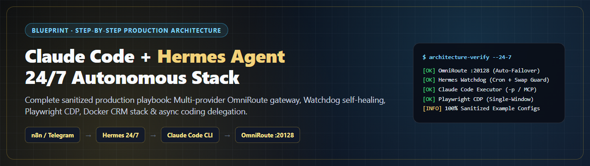
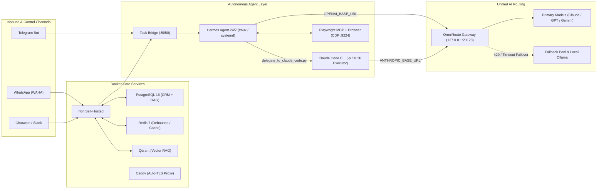

<div align="center">
  

  <p>
    <a href="README.md"></a>
    <a href="README.es.md"></a>
    
    
    
    
  </p>

  <h3>Production Step-by-Step Blueprint: Autonomous 24/7 AI Agency & Coding Stack</h3>
  <p>
    How to architect, configure, harden, and operate <b>Hermes Agent</b> + <b>Claude Code CLI</b> + <b>OmniRoute AI Gateway</b> + <b>n8n / WAHA / Playwright</b> on Linux VPS &amp; Windows workstations with zero single points of failure.
  </p>
</div>

---

> [!CAUTION]
> **100% Sanitized Public Blueprint:** All configuration files, environment templates, IP addresses (`198.51.100.10`), domains (`your-domain.example.com`), API keys (`sk-example-replace-me`), and accounts (`agency@example.com`) in this repository are **fictional examples**. Never commit real `.env` files, SQLite databases, OAuth tokens, or SSH keys to public repositories. See [SECURITY.md](SECURITY.md).

---

## Architecture Overview

In a high-availability autonomous agency stack, **Hermes Agent** acts as the **24/7 always-on orchestrator** (handling client triage, scheduled routines, memory, MCP tools, and browser control), while **Claude Code CLI** acts as the **heavy engineering executor** (scaffolding projects, refactoring codebases, running test suites, and rendering programmatic media). Both route through **OmniRoute** (`http://127.0.0.1:20128/v1`) for multi-provider auto-failover, rate-limit resilience, and model/effort switching.



---

## Step-by-Step Documentation Index

Follow these guides in order to reproduce the complete setup from a fresh Linux VPS or Windows workstation:

| Step | Guide | What You Will Build |
| :--- | :--- | :--- |
| **01** | [**VPS Bootstrap, Swap/ZRAM & KDE/xRDP**](docs/01-vps-bootstrap-kde-xrdp.md) | Ubuntu LTS hardening, 4–6 GB swap/zram tuning for low-RAM servers, Node.js v24, Python 3, Docker Compose, KDE/Xvfb (`DISPLAY=:10` & `:99`), SSH hygiene, and multi-node scaling blueprint. |
| **02** | [**OmniRoute AI Gateway & Auto-Failover**](docs/02-omniroute-gateway-setup.md) | Installing OmniRoute on `127.0.0.1:20128`, avoiding IPv6 `localhost` traps, Smart Auto-Combos with mandatory tool-calling + `>=128k` context, SQLite WAL resilience, and OAuth refresh isolation. |
| **03** | [**Claude Code CLI & Project Executor Setup**](docs/03-claude-code-integration.md) | Wiring `~/.claude/settings.json` to OmniRoute, dynamic `/model` + reasoning effort selector, headless CI/delegation flags (`-p`, `--allowedTools`, `--output-format json`), `CLAUDE.md`, Remotion & GitHub MCP. |
| **04** | [**Hermes Agent 24/7 & Multi-Worker DAG**](docs/04-hermes-agent-24-7.md) | Installing `NousResearch/hermes-agent`, `.env` vs `config.yaml` split, critical guardrails (`busy_input_mode: queue`, `loop_watchdog`), `AGENTS.md`/`SOUL.md`, PostgreSQL DAG queue, and Hermes → Claude Code handoffs. |
| **05** | [**Playwright MCP & Brave/Chrome CDP Automation**](docs/05-browser-automation-playwright-brave.md) | `@playwright/mcp` integration, single-window & tab-group RAM hygiene on VPS, Windows `WinSta0\Default` `CreateProcess` daemon launcher, and native OS cursor preservation. |
| **06** | [**24/7 Watchdog, Task Bridge & Docker Stack**](docs/06-watchdog-monitoring-and-omnichannel.md) | Minute-by-minute cron Watchdog (`<400 MiB` RAM guardian), `hermes_task_bridge.py` (`:5050`), Telegram Command Center, and Docker Compose (`Postgres + Redis + n8n + WAHA + Qdrant + Caddy`). |
| **07** | [**Production Troubleshooting Runbook**](docs/07-troubleshooting-runbook.md) | Battle-tested fixes for HTTP 400 non-tool models, HTTP 403 gating, WebSocket `1006`, `SQLite database is locked`, context overflow, loop drift, and Windows console popups. |

---

## Repository Structure

```text
claude-code-hermes-24-7-automation/
├── README.md                              # English blueprint overview
├── README.es.md                           # Guía completa en Español
├── SECURITY.md                            # Secret hygiene & credential rotation policy
├── LICENSE                                # MIT License
├── assets/
│   └── hero-banner.png                    # Repository visual banner
├── docs/
│   ├── 01-vps-bootstrap-kde-xrdp.md
│   ├── 02-omniroute-gateway-setup.md
│   ├── 03-claude-code-integration.md
│   ├── 04-hermes-agent-24-7.md
│   ├── 05-browser-automation-playwright-brave.md
│   ├── 06-watchdog-monitoring-and-omnichannel.md
│   └── 07-troubleshooting-runbook.md
├── configs/
│   ├── .env.example                       # Sanitized environment variables template
│   ├── hermes-config.example.yaml         # Production-hardened Hermes config.yaml
│   ├── claude-settings.example.json       # Claude Code OmniRoute + /model wiring
│   ├── CLAUDE.example.md                  # Claude Code Project Executor contract
│   ├── AGENTS.example.md                  # Hermes Agent operational rules & OAuth policy
│   ├── SOUL.example.md                    # Agent identity & safety boundaries
│   └── Caddyfile.example                  # Reverse proxy with automatic HTTPS
├── docker/
│   ├── docker-compose.example.yml         # Postgres + Redis + n8n + WAHA + Qdrant
│   └── init_db.sql                        # CRM leads, proposals, and task handoff schema
├── scripts/
│   ├── hermes_watchdog.example.sh         # Cron watchdog + <400 MiB RAM protector
│   ├── hermes_task_bridge.py              # Zero-dependency HTTP -> tmux task dispatcher
│   ├── delegate_to_claude_code.example.py # Async Hermes -> Claude Code CLI handoff
│   └── launch_browser_win.example.ps1     # WinSta0\Default CDP browser launcher
└── systemd/
    ├── omniroute.service.example          # Systemd unit for OmniRoute (:20128)
    └── hermes-agent.service.example       # Systemd unit for Hermes Gateway
```

---

## Quick Start (Sanitized Example Flow)

```bash
# 1. Clone this blueprint
git clone https://github.com/agenciaiaonline-wq/claude-code-hermes-24-7-automation.git
cd claude-code-hermes-24-7-automation

# 2. Prepare environment file from sanitized template (NEVER commit .env)
cp configs/.env.example .env
# Edit .env with your own API keys, passwords, and domain placeholders

# 3. Install & verify OmniRoute AI Gateway on 127.0.0.1:20128
npm install -g omniroute
curl -s http://127.0.0.1:20128/health

# 4. Configure Claude Code CLI to route through OmniRoute
mkdir -p ~/.claude
cp configs/claude-settings.example.json ~/.claude/settings.json
cp configs/CLAUDE.example.md ~/client_projects/CLAUDE.md

# 5. Install Hermes Agent & apply hardened configuration
curl -fsSL https://hermes-agent.nousresearch.com/install.sh | bash
mkdir -p ~/.hermes
cp configs/hermes-config.example.yaml ~/.hermes/config.yaml
cp configs/AGENTS.example.md ~/.hermes/AGENTS.md
cp configs/SOUL.example.md ~/.hermes/SOUL.md

# 6. Launch supporting Docker Core stack (Postgres, Redis, n8n, WAHA, Qdrant)
docker compose -f docker/docker-compose.example.yml --env-file .env up -d

# 7. Enable Watchdog cron (every 60s)
chmod +x scripts/hermes_watchdog.example.sh
(crontab -l 2>/dev/null; echo "* * * * * $(pwd)/scripts/hermes_watchdog.example.sh >> /var/log/hermes_watchdog.log 2>&1") | crontab -
```

---

## Hardware Sizing Recommendations

| Deployment Profile | Specs | Concurrency | Best For |
| :--- | :--- | :--- | :--- |
| **Entry Single VPS** | 2 vCPU · 4 GB RAM · 6 GB Swap | 2–3 subagents | Prototyping, 1–2 client bots, light Playwright tabs |
| **Production Monolith** | 8 vCPU · 32 GB RAM · 250+ GB NVMe | 6–8 subagents | Combined OmniRoute + Docker CRM + Claude Code builds |
| **Split 2-Node VPC** *(Recommended)* | **Core Node:** 2 Dedicated vCPU · 16 GB RAM<br>**Worker Node:** 8+ vCPU · 16 GB RAM | 8–12 subagents | Zero-downtime WhatsApp/n8n/Postgres isolated from heavy Remotion/Docker/Claude Code jobs |

---

## Reference Upstream Ecosystems

This blueprint combines production field-engineering with best practices from:
- [`NousResearch/hermes-agent`](https://github.com/NousResearch/hermes-agent) — Autonomous self-improving agent runtime, `config.yaml`, `SOUL.md`, cron, and messaging gateways.
- [`cheaper-inference/OmniRoute`](https://github.com/cheaper-inference/OmniRoute) — Open-source AI gateway, quota-aware failover, and token compression.
- [Claude Code CLI Documentation](https://docs.anthropic.com) — `settings.json`, `ANTHROPIC_BASE_URL`, headless `-p` automation, and MCP servers.
- [`affaan-m/everything-claude-code`](https://github.com/affaan-m/everything-claude-code) — Operator shell & execution substrate patterns (`HERMES-SETUP.md`).

---

<div align="center">
  <p>Maintained by <b>Golden Nodalix — AI & Software Engineering Studio</b></p>
  <p>
    <a href="https://github.com/agenciaiaonline-wq">GitHub Portfolio</a> ·
    <a href="https://www.linkedin.com/in/agency-golden-nodalix-880598438/">LinkedIn</a> ·
    <a href="https://github.com/agenciaiaonline-wq/high-ticket-ai-automation-catalog">Service Catalog</a>
  </p>
</div>
